<p align="center">
  
</p>

<p align="center">
  <a href="https://github.com/netspeedy/s3ctl/releases"></a>
  <a href="LICENSE"></a>
  <a href="https://github.com/netspeedy/homebrew-s3ctl"></a>
  <a href="https://github.com/netspeedy/s3ctl"></a>
  <a href="https://buymeacoffee.com/soakes"></a>
</p>

---

This is the Homebrew tap for [s3ctl](https://github.com/netspeedy/s3ctl). s3ctl creates S3-compatible buckets and gives each one its own access key, with a policy that only allows access to that bucket. It works with any S3/IAM-compatible endpoint and with OVHcloud Public Cloud Object Storage.

## Install

```bash
brew tap netspeedy/s3ctl
brew install s3ctl
```

The formula installs a prebuilt binary on macOS (Apple silicon and Intel) and Linux (amd64, arm64 and armv7).

> On recent Homebrew, new third-party taps require explicit trust. If installation is refused, run `brew trust netspeedy/s3ctl` once, then `brew install s3ctl`.

## Try it

Plan a bucket and its scoped credentials without changing anything:

```bash
s3ctl --bucket app-data --create-scoped-credentials \
  --endpoint https://objects.example.com --dry-run
```

It prints the plan:

```text
S3 Provisioning Result
======================
Resources: 1
Mode: dry-run

Bucket: app-data
Endpoint: https://objects.example.com
Region: us-east-1
Bucket create planned: yes
Versioning requested: no
Encryption requested: no
Bucket policy planned: no
Scoped credentials planned: yes
IAM user: app-data
Credential policy template: bucket-readwrite
Access key ID: (generated on apply)
Secret access key: (generated on apply)
```

Drop `--dry-run` to create the bucket and print the new key. s3ctl finds credentials the same way the AWS CLI does, or you can pass `--profile`. Add `--output json` if a script is reading the result. For OVHcloud, pass `--provider ovh`, an OVHcloud region such as `--region UK`, and `--ovh-service-name` with your Public Cloud project ID. `s3ctl --help` has the common workflows, and the [usage guide](https://github.com/netspeedy/s3ctl/blob/main/docs/usage.md) covers batch files, credential rotation and safe deletion.

## Upgrade or remove

```bash
brew upgrade s3ctl
brew uninstall s3ctl
brew untap netspeedy/s3ctl
```

## Available formulae

| Formula | Description |
|---|---|
| [`s3ctl`](Formula/s3ctl.rb) | S3-compatible bucket provisioning and scoped credential automation |

## About this tap

This repository only packages [`Formula/s3ctl.rb`](Formula/s3ctl.rb). The s3ctl release workflow rewrites it for each stable [release](https://github.com/netspeedy/s3ctl/releases); release candidates aren't published here. The APT repository, install script and container image are described in the [installation guide](https://github.com/netspeedy/s3ctl/blob/main/docs/installation.md). Please open issues in the [main repository](https://github.com/netspeedy/s3ctl/issues).

The banner at the top of this page is generated. Edit the copy, layout or timing in `.github/scripts/build_readme_hero.py` and run it to rebuild `assets/s3ctl-readme-hero.svg`. It downloads the font subsets from Google Fonts, so it needs network access.

## License

Copyright © 2026 [Simon Oakes](https://github.com/soakes). Released under the [MIT License](LICENSE).

This tap only packages the [s3ctl](https://github.com/netspeedy/s3ctl) formula, an unofficial community tool that is not affiliated with, endorsed by, or sponsored by AWS, Amazon S3, or OVHcloud.
